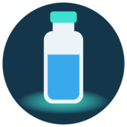

# HidrateSpark Bottle for Home Assistant

Use your HidrateSpark smart bottle from Home Assistant, over Bluetooth, with no app, account or
cloud. It's a community project and is [not affiliated with Hidrate](#disclaimer).

> [!WARNING]
> **Status: early, and run on two bottles only.** On a Steel with firmware 53.63, installed through
> HACS, it connects through a Bluetooth proxy with no pairing, syncs by itself while the bottle stays
> in range, has read real sips with plausible times and amounts, makes the bottle glow with Find, and
> has set glow reminders that fired on time with nothing connected.
> A second bottle, a 946 mL Pro with firmware 90.11, has connected and synced straight out of the box,
> never set up with the app. It was calibrated empty then full from here, and one measured pour of
> 250 mL then read as 235 mL. Filled to its line it holds about 1015 mL, not 946, and set to that its
> amounts come out right. It glowed on Find only once a glow colour had been set from here. Read
> [what it writes to your bottle](docs/what-it-writes.md) before you install it.

The point of publishing it is so other owners can report their bottles and get them working. If
yours isn't in the table below, [please report it](CONTRIBUTING.md#report-your-bottle).

## What it replaces

| From the app | Here |
|---|---|
| Sips | `Last sip` sensor with the amount. Every sip is kept in Home Assistant for 90 days |
| Daily totals | `Today` and `Yesterday` sensors. Totals are kept for good, and `Today` carries the last 14 days in its `daily_totals` attribute |
| Daily goal | `Goal progress` sensor |
| Glow reminders | Optional, and off until you turn them on. The schedule is built from your goal, wake time, bedtime and frequency, which you can change from the device page or an automation |
| Water level | `Water left` sensor, in mL, with `percent`, `as_of`, `source` and `reading` attributes. Press `Mark empty` with the bottle empty and `Mark full` with it full, and it reads the bottle's weight value at every sync. Until both are pressed, or if a reading can't be had, it's where the latest sip stopped, so a refill doesn't show until the next sip |
| Refills | `Last refill` sensor, with `amount_ml` and `exact_time` attributes. Usually noticed when the next sip starts higher than the last one stopped, so it means "by this time" unless `exact_time` is true |
| Battery | `Battery` sensor, and `Last charged`: the last sync that found the bottle on its charger, so roughly when it came off. On a bottle whose `Battery` reading can't be trusted, time since `Last charged` is the better guide |
| Charging | `Charging` binary sensor, and `Battery state`: charging, charged or not charging. Both come from the bottle's own status at each sync. On its charger the bottle syncs at least every 5 minutes, and for 15 minutes after, which costs its battery nothing, so lifting it off shows within minutes |
| Find my bottle | `Find` button |
| Marks | `Mark empty` and `Mark full` buttons. These only remember a reading in Home Assistant and write nothing to the bottle, so pressing one again puts it right |
| Calibration | `Calibrate empty` and `Calibrate full` buttons, disabled by default so they can't be pressed by accident |
| Glow colour | `Glow colour` select with eight colours, disabled by default. Firmware 50 to 59, and 80 to 99. [It changes the bottle's own settings, at your own risk](docs/what-it-writes.md#only-when-you-change-the-glow-colour) |

There's also a `Sync now` button and a `Last sync` sensor, whose `last_error` attribute tells you
what went wrong if a sync failed. Now and then a connection finds the bottle's services with one
missing, and every connection after reuses that copy and fails with "Characteristic … was not
found". When that happens the sync clears the copy and tries once more straight away.

## What doesn't carry over

- **App history.** Nothing already in your Hidrate account comes across. Your record starts with
  what's on the bottle when you first connect.
- **Snooze.** There's no way to snooze a reminder.
- **Free-choice glow colours.** Only the eight named colours are offered.
- **Health Connect.** Sips aren't written to Health Connect or Apple Health. They live in Home
  Assistant, and you can feed them onward from there.
- **Firmware updates.** This integration will [never do these](docs/what-it-writes.md#what-it-never-writes).

## Things to know before you switch

**Use this or the app, not both.** The bottle takes one connection at a time, and a sip is handed
over only once. If the app is running too, each one ends up with part of your day, and
it can block this integration from connecting at all. Close the app while you try this, and
uninstall it when you're happy.

**Sips wait on the bottle until it's home.** There's no phone in your pocket doing the syncing any
more, so nothing is read while the bottle is out of range of Home Assistant, unless you set up the
optional [phone relay](docs/phone-relay.md). Sips taken away stay on
the bottle. When it comes home they land on the day you drank them, because each one records how
long ago it happened. How many a bottle can hold isn't known yet. A sip that comes home late can't
change what `Today` recorded on the day you drank it, so use `daily_totals` for history.

**Set your bottle's size when you add it.** Sip amounts are calculated from it. The 621 mL it offers
is only right for one model.

**Watch the battery for the first week.** It syncs every 30 minutes by default. You can change that
in the options.

## Requirements

- Home Assistant 2025.1 or newer, with the Bluetooth integration set up. It has only been run on
  2026.10, so older versions are untested. CI imports it against the latest release. The icon needs 2026.3.
- A Bluetooth adapter, or a [Bluetooth proxy](https://esphome.io/components/bluetooth_proxy.html) that
  allows active connections, in range of where the bottle usually sits. A passive-only proxy can't
  read it, because the bottle's adverts carry no readings.

## Install

### With HACS

Or by hand:

1. In HACS, open the menu at the top right and choose **Custom repositories**.
2. Add `https://github.com/tech2urdoor/ha-hidrate-spark` with the type **Integration**.
3. Find **HidrateSpark Bottle** in HACS, download it, and restart Home Assistant.

### By hand

Copy `custom_components/hidrate_spark` into your Home Assistant `custom_components` folder, then
restart.

### Then

1. Close the Hidrate app if you have it, or the bottle won't be free.
2. Once Home Assistant hears the bottle, it should offer it under **Settings → Devices & services**.
   If it doesn't, choose **Add integration** and search for HidrateSpark.
3. Enter your bottle's size when it asks. If you run [Bermuda](https://github.com/agittins/bermuda),
   there's also a tick box to have Bermuda track which room the bottle is in. See below.
4. Press **Sync now**, then check that `Last sync` updates.

### Bermuda

If the [Bermuda](https://github.com/agittins/bermuda) integration is installed and running, setup
offers **Track which room it's in with Bermuda**, off unless you tick it. Ticked, it adds the bottle
to the devices picked in Bermuda's **Select Devices** setting, alongside whatever's there already,
by going through that setting the way you would. Bermuda then shows the bottle under the name it
advertises, starting `h2o`, which you can rename on its device page. Nothing is written to the
bottle for this.

Bermuda's settings aren't meant to be changed by other integrations, so if anything about them is
unexpected, setup changes nothing in Bermuda, tells you how to add the bottle yourself, and carries
on. Bermuda can only pick a device it has already heard, so if the bottle is new to it, that's the
likely reason. **Untested on a real setup:** the automatic path has only run in tests, against
the flow seen in Bermuda's own settings. Adding a bottle by hand in Bermuda works.

## Options

These are on the integration's **Configure** screen. The ones marked *Control* are also entities in
the device page's Configuration section, so a dashboard or automation can change them. Both are the
same setting, and a change goes to the bottle at the next connection, about a minute later if it's
in range. While reminders are off, changing the others sends nothing to the bottle.

| Option | Default | |
|---|---|---|
| Send glow reminders to the bottle | Off | *Control.* Off means the bottle is only read. Turning it on replaces the bottle's schedule |
| Daily goal | 2000 mL | *Control* |
| Wake time, Bedtime | 07:00, 22:00 | *Control.* Reminders are spaced between these |
| Minutes between reminders | 60 | *Control.* 0 for none. The first comes one interval after wake time. The bottle holds 12 at most, and any after that are dropped. The defaults give 15, so reminders stop at 19:00. Every 75 minutes covers that day |
| Glow | High | *Control.* High, medium, low, short pulse, short white pulse, pulse effect, spin effect, flash effect. Used for reminders and Find. An effect repeats by itself from one press of Find: the flash effect plays three times in a row |
| Glow at every reminder | Off | *Control.* Otherwise only when you're behind |
| Glow on each sip | On | |
| Glow when the goal is reached | On | |
| Bottle size | 621 mL | What the bottle holds filled to its line, which can be more than the size it's sold as. Sips and `Water left` are shares of it. To check yours, pour a measured amount out of a full bottle, sync, and multiply the size by what you poured over what it read |
| Minutes between syncs | 30 | More often is kinder to reminders and harder on the battery. On its charger it's at most 5 |
| Let a phone read the bottle away from home | Off | For the [phone relay](docs/phone-relay.md). The next screen shows the address to give the app. **Untested on a real bottle** |

## Bottle compatibility

**Works** means seen working on a real bottle. **Untested** means written from the protocol and never
run on a real bottle. **Refused** means the integration stops before reading a sip.

| Bottle | Firmware | Connects | Sips | Reminders | Battery | Find | Calibrate |
|---|---|---|---|---|---|---|---|
| Steel, 621 mL | 53.63 | Works | Works, two real sips so far | Works, two watched at times only this integration had set | Reads a value, but not a measure of charge: it read 33 a minute after a full charge. Charging read right on its charger and off it. Charged not seen yet | Works | Works: pressed empty then full, and the next sip's stored empty and full readings matched the bottle's own level readings at those presses. A 250 mL pour then read as 249. It doesn't light up for either press |
| Pro, 946 mL | 90.11 | Works, never set up with the app | Works, two measured pours so far: 250 mL read as 235 and as 233 with Bottle size at 946. That makes its line about 1015 mL, so set Bottle size to that | Not working yet. Once a glow colour was set, one sip glowed but was never recorded, and the next two were recorded but didn't glow | Reads a value, but it said 9% while the bottle's own lights showed fully charged. It read 100 off the charger after a full charge. Charging read right on its charger and off it. Charged not seen: full on its charger, it stopped charging for about a minute and then started again, and read not charging in that minute | Works, but only once a glow colour was set. Before that it showed nothing | Works: pressed empty then full out of the box, then again later. The stored empty and full readings changed with the second calibration. A 250 mL pour read as 235 after the first and 233 after the second. It flashes for each press |
| Any other, firmware 40–99 | | Untested | Untested | Untested | Untested | Untested | Untested |
| Older bottles, firmware 8–19 and 30–39 | | Untested | Untested, see below | Untested | Untested | Untested | Untested |
| Firmware below 8, or 20–29 | | Untested | Refused | Refused | Refused | Untested | Untested |
| Firmware 100 and up | | Untested | Refused | Refused | Refused | Untested | Untested |

**Every bottle but the Steel's family** (firmware 50–59) has each sip's record kept exactly as the
bottle sent it, because no other family has been seen reading sips over days. If the reading turns
out wrong, or a bottle that was never calibrated sends sips that work out to nothing, the amounts can
be worked out again from those records rather than lost.

**The Pro** (firmware 90.11) keeps its glow colour apart from its other settings, and one never set up
with the app has none at all. Find showed nothing on it until `Glow colour` had written one, and then it glowed, so set a colour
first if yours stays dark. It refuses a
plain read of its weight value, so `Water left` comes from sips and the mark buttons can't get a
reading. It came uncalibrated out of the box and was calibrated from here before its first sip, so
whether an uncalibrated one reads sips right still isn't known. Calibrate it empty, then full, before
you drink from it, as the app would have had you do.

**Older bottles** (firmware 8–19 and 30–39, which includes bottles sold as the Spark 3) are read the
same way as newer ones, and those below 30 are also sent the acknowledgement they expect after each
sip. No one has run these with this integration yet. Amounts are a straight share of the bottle. The app is believed
to adjust readings on these bottles when they're nearly full or nearly empty, so amounts there may
differ from what the app showed. Most of these bottles hold 592 mL (20 oz), so enter that at setup
unless yours is different.

`Last refill` has found one refill in the Steel's real sip records, at about the time one was watched. The bottle
sending its own record of a refill hasn't been seen.

The weight value has been measured on that Steel with one set of pours. 160 mL out and back moved it and returned it
to within 2 units, and it stayed in proportion from full to empty. The line on the bottle held about 650 mL by
measuring cup, against the 621 mL the bottle stores as its size. It's left at 621, so amounts read a little low. `Mark empty` and `Mark full` have been pressed on it,
and `Water left` then read 100% with the bottle full. A level is only as fresh as the last sync. Nothing has yet
checked it with the bottle tilted or over days, and no other bottle has been tried.

Pouring water out looks like a sip to the bottle, so it counts towards `Today`. On the Steel, the `Battery` reading
jumped around and fell after charging, to 33 a minute after a full charge, so don't rely on it as a measure of charge.
`Last charged` gives the time since the last charge instead. Both bottles have read 100 on
their chargers while still reporting that they were charging. `Charging` and `Battery state` come from that separate
status, so use those to tell whether it's charging.

All eight glow colours have been tried on the Steel above and work. A change can fail with
"Not connected", which leaves the colour as it was, so try it again.

A change to a control on the device page has been seen reaching the bottle's next sync, about a
minute later and with no error.

The bottle is called a Steel because of how the app treats its firmware number. Reminders on it
can't be checked by reading them back, so the proof was watching it glow on time, with nothing
connected, at minutes the app had never been set to. A schedule set by the app can stay on the
bottle, so a reminder at a time the app also used proves nothing.

The supported ranges come from reading the protocol. Only 53.x and 90.11 have had sips read. Yours
can change that:
[report your bottle](CONTRIBUTING.md#report-your-bottle).

To find your firmware version, run the probe below. You don't need to read any sips.

## The probe

**Developer Tools → Actions → `hidrate_spark.probe`** gives a read-only look at the bottle. It takes
no sips and writes nothing. Its output removes your serial number and Bluetooth addresses, so it's
safe to paste into an issue. If you have more than one bottle, choose which one.

## Privacy

Everything stays on your Home Assistant. This integration talks to no server, needs no account and
sends no telemetry. The optional phone relay sends what it reads to your own Home Assistant and
nowhere else. Sips are stored in Home Assistant's `.storage` folder, and your backups will
include them.

## Docs

- [What it writes to your bottle](docs/what-it-writes.md), and what it never writes
- [The bottle's protocol](docs/protocol.md)
- [Phone relay](docs/phone-relay.md), for syncing while the bottle is away from home
- [Contributing](CONTRIBUTING.md)

## Disclaimer

This project is not affiliated with, endorsed by, or supported by Hidrate, Inc. HidrateSpark is
their trademark, used here only to say which bottles this works with. No Hidrate code, text or
artwork is included. The protocol was worked out for interoperability.

It's offered as is, under the [MIT licence](LICENSE), with no warranty. It writes to a device you
own, and that could affect your bottle or its warranty. It isn't a medical device, so don't rely on
it for anything medical.
